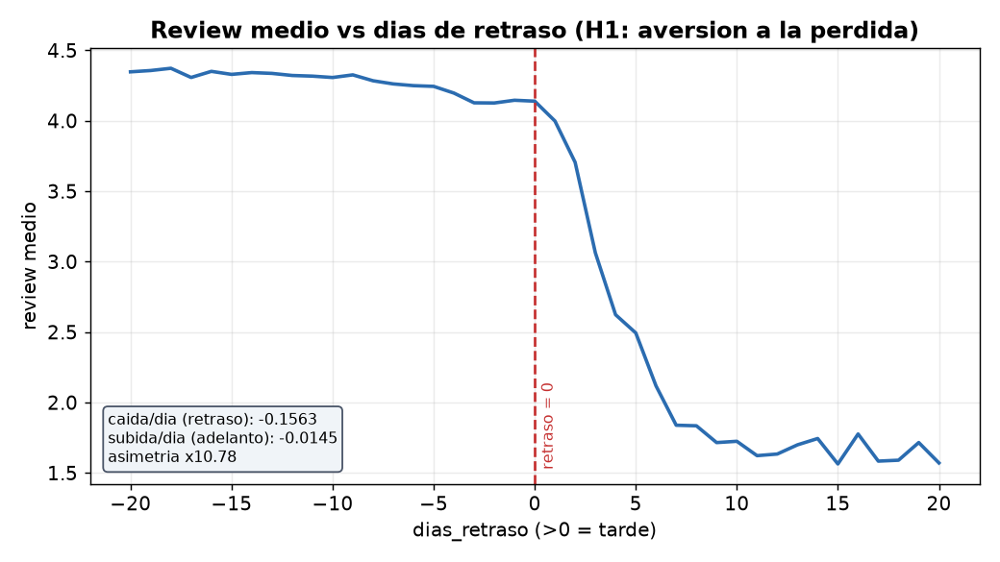
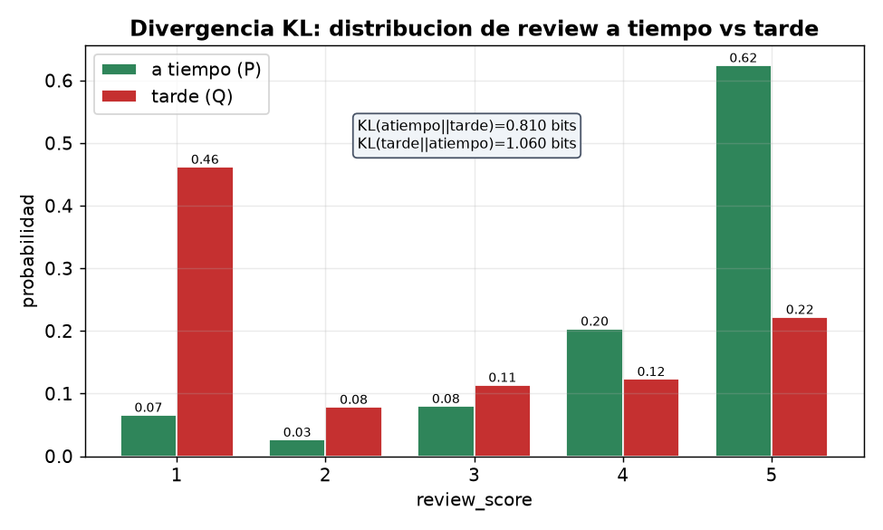
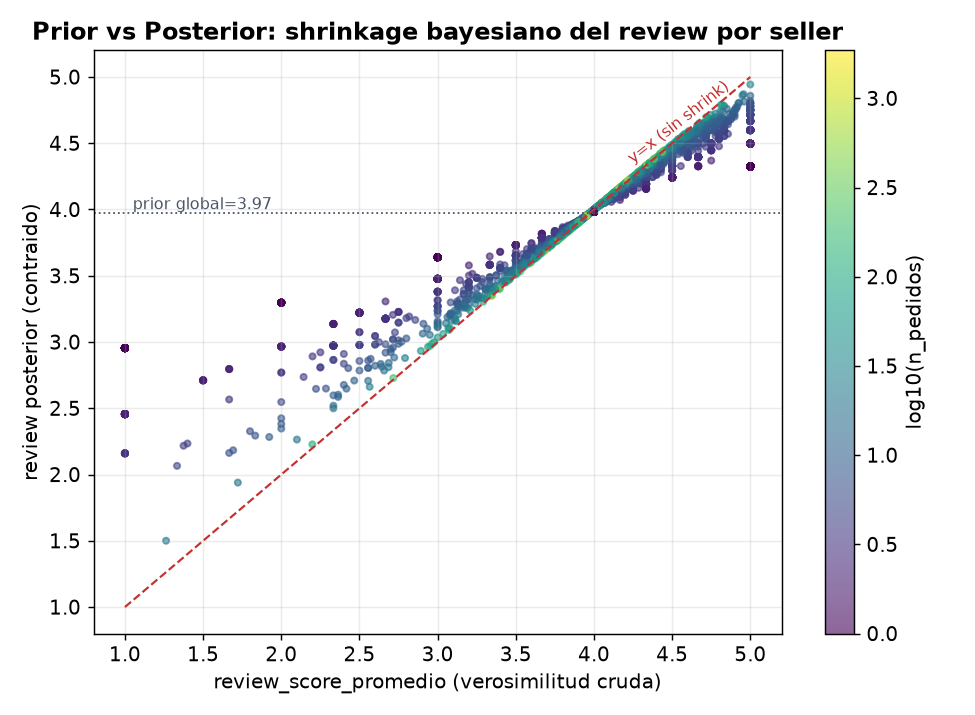

# Olist — Análisis Probabilístico de Satisfacción de Clientes

[](reproducir_informe.py)
[](https://www.python.org/)
[](LICENSE)

> **¿Qué factores probabilísticos explican la calificación de un cliente en el mayor marketplace de Brasil?**
> 96 000 pedidos · 2016–2018 · 11 conceptos estadísticos · 4 hipótesis · 100% reproducible

<div align="center">

[](outputs/reports/informe_ejecutivo_olist.pdf)

</div>

---

## El hallazgo más importante en una imagen

El "codo" en `retraso = 0` lo dice todo: la nota **se desploma** justo al cruzar la fecha prometida.
No se trata de velocidad sino de **cumplir la promesa**.



**P(reseña 1–2 ★ | llegó tarde) = 54 % vs P(reseña 1–2 ★ | llegó a tiempo) = 9 %** — un riesgo 6× mayor.

---

## Las dos distribuciones que cuentan la misma historia

Pedidos a tiempo y pedidos tardíos no son variantes del mismo comportamiento: son **mundos distintos**
(divergencia KL = 0,81 bits).



---

## Shrinkage bayesiano: cómo evaluar a un vendedor con pocos pedidos

Un vendedor con 1 solo pedido y 5 ★ no "vale" 5,0. Su nota se *encoge* hacia el promedio global
(posterior ≈ **4,33**, pseudo-conteo κ = 1,92). Los vendedores con muchos pedidos convergen;
los pequeños son el grupo impredecible.



---

## Los cuatro hallazgos en 30 segundos

| # | Hallazgo | Métrica clave |
|---|----------|---------------|
| H1 | **Cumplir la fecha prometida es lo que más importa** | P(1–2★ \| tarde) = 54 % vs 9 %; asimetría de efecto 10,8× |
| H2 | **Pedidos multi-ítem son el problema silencioso** | Detractores: 7,5 % (1 ítem) → 32 % (4+ ítems); ~173 evitables/10 k pedidos hoy |
| H3 | **No culpes al vendedor por lo que no controla** | Solo 11–14 % de su calificación depende de él |
| H4 | **Pago, flete y categoría no mueven la aguja** | V de Cramér = 0,018 (efecto nulo); log-loss solo baja −8,5 % |

---

## Conceptos estadísticos cubiertos

El análisis aplica los 11 conceptos de forma funcional (no decorativa) sobre datos reales:

| # | Concepto | Dónde se usó |
|---|----------|--------------|
| 1 | Probabilidad condicional | P(1–2★ \| tarde) = 54 % vs 9 % |
| 2 | Teorema de Bayes | Dado 1★ → P(hubo retraso) = 38 %, lift 4,7× |
| 3 | Verosimilitud / MLE | Flete ~ log-normal, mejor AIC |
| 4 | Distribuciones paramétricas | Tiempo de entrega y precio: log-normales (KS 0,03) |
| 5 | Esperanza y varianza | E(review) = 4,09; ρ² ≈ 1,1 % para n_items |
| 6 | Independencia y correlación | Spearman: distancia↔entrega ρ = 0,54; review↔retraso ρ = −0,18 |
| 7 | Prior y posterior (shrinkage) | Nota vendedor con 1 pedido: 5,0 → 4,33 |
| 8 | Entropía de Shannon | Pago aporta 1,02 bits (eficiencia 0,44) |
| 9 | Entropía cruzada | Clasificador: log-loss 0,515 → 0,471 (AUC 0,66) |
| 10 | Divergencia KL | A tiempo vs tarde = 0,81 bits; SP vs Nordeste = 0,03 bits |
| 11 | Chi² / V de Cramér | Pago × reseña: efecto nulo (V = 0,018) |

**Extra:** simulación **Monte Carlo** (prueba de permutación + bootstrap + cluster bootstrap por vendedor) para validar el efecto de los pedidos multi-ítem y construir intervalos de confianza honestos.

> Regla de la casa: todas las decisiones se tomaron por **tamaño de efecto**, no por p-valores. Solo se usaron pruebas **no paramétricas** (0 de 21 variables numéricas pasaron Shapiro-Wilk + Anderson-Darling).

---

## Estructura del repositorio

```
.
├── data/
│   ├── raw/                    # 9 CSVs originales de Olist (no se tocan)
│   └── processed/              # datasets limpios y encodificados
├── outputs/
│   ├── charts/                 # 8 gráficas estáticas (PNG)
│   └── reports/                # informe ejecutivo (PDF + LaTeX + MD)
├── dashboard/                  # dashboard interactivo (HTML standalone)
├── analisis_inferencial.py     # análisis principal: 11 conceptos + 4 hipótesis
├── analisis_comportamiento.py  # comportamiento y métricas de vendedores
├── analisis_categoricas.py     # variables categóricas (Chi², V de Cramér)
├── encoding_features.py        # encoding y preparación de features
├── pruebas_normalidad.py       # tests Shapiro-Wilk + Anderson-Darling
├── reproducir_informe.py       # 64/64 checks de reproducibilidad
└── gen_reporte.py              # compilación del informe LaTeX a PDF
```

---

## Reproducibilidad

```bash
# 1. Instalar dependencias
pip install pandas numpy scipy scikit-learn matplotlib seaborn statsmodels

# 2. Ejecutar el análisis completo
python analisis_inferencial.py

# 3. Verificar los 64 checks
python reproducir_informe.py
```

Todos los resultados numéricos del informe ejecutivo están serializados en
`outputs/reports/resultados.json` y verificados automáticamente por `reproducir_informe.py`.

---

## Dataset

[Brazilian E-Commerce Public Dataset by Olist](https://www.kaggle.com/datasets/olistbr/brazilian-ecommerce) - 9 tablas,
~96 000 pedidos entregados, 2016–2018. Los archivos crudos van en `data/raw/` (no incluidos en el repo por tamaño;
descargar de Kaggle).

---

## Autor

**Andrés Padilla** - Análisis de datos · Estadística aplicada · Python  
[LinkedIn](https://www.linkedin.com/in/andrespadilla) · padillachl815@gmail.com

---

*Asociaciones observacionales, no causales. Reproducible con `reproducir_informe.py`.*
